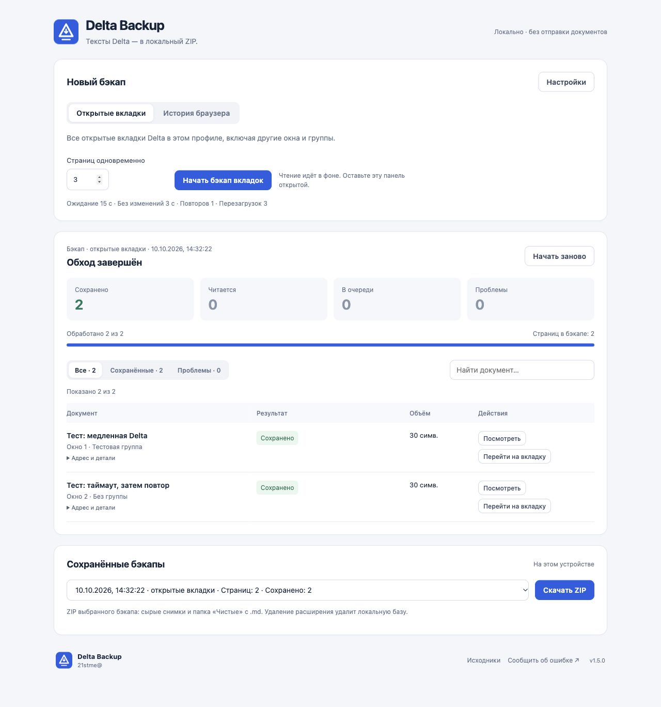

#  Delta Backup

Локальный бэкап текстов открытых вкладок [Delta](https://delta.yandex-team.ru/) для Яндекс Браузера и Google Chrome. Текущая версия: **1.5.0**.



## Что умеет

- Собирает вкладки Delta во всех окнах и группах, читает их в фоне без переключения фокуса и прокрутки.
- Ждёт медленные страницы; перезагружает зависшую загрузку или страницу с просьбой «попробуйте перезагрузить страницу».
- Обрабатывает несколько страниц одновременно. Есть пауза, продолжение, новый проход и повтор ошибок.
- Хранит результаты в локальной базе и показывает сохранённые бэкапы.
- Отдельно ищет ссылки Delta в истории браузера и сохраняет текущий текст выбранных документов.
- Выгружает ZIP: сырые снимки, отчёт и плоскую папку **«Чистые»** с `.md`.

Обработка выполняется на компьютере: без AI, отправки документов на серверы или сторонних библиотек. Переход по ссылкам GitHub в панели открывает внешний сайт по вашему нажатию.

## Установка

1. Скачайте ZIP расширения из [Releases](https://github.com/21stme/delta-backup/releases) и распакуйте его в постоянную папку.
2. Откройте `browser://extensions/` в Яндекс Браузере или `chrome://extensions/` в Chrome.
3. Включите **«Режим разработчика»** → **«Загрузить распакованное расширение»**.
4. Выберите папку `delta-backup-extension`, в которой лежит `manifest.json`.
5. Нажмите **«Delta — локальный бэкап вкладок»** в меню расширений.

При работе с исходниками вместо папки из ZIP выбирайте `extension/`. Подробная короткая инструкция также лежит в [docs/УСТАНОВКА.txt](docs/УСТАНОВКА.txt).

### Обновление

Приостановите обход и закройте панель. Замените файлы **в прежней папке установки**, нажмите **«Обновить» / Reload** на карточке расширения и откройте панель снова. Не удаляйте расширение: удаление удалит его локальную базу бэкапов. Перемещение установки в новую папку может создать другой ID и отдельную базу.

## Первый бэкап

Откройте нужные вкладки Delta в профиле с установленным расширением. Вверху панели выберите **«Открытые вкладки»** и нажмите **«Начать бэкап вкладок»**. Панель должна оставаться открытой; другими вкладками можно пользоваться. Внизу выберите сохранённый бэкап и нажмите расположенную рядом кнопку **«Скачать ZIP»**.

Настройки по умолчанию: ожидание **15 с**, текст без изменений **3 с**, **1** повтор после первого прохода, до **3** перезагрузок на попытку и **3** страницы одновременно. Чтение готовой страницы заканчивается раньше лимита, если текст перестал меняться. После каждой перезагрузки начинается новый полный лимит.

Для истории переключите источник на **«История браузера»**, найдите ссылки, выберите документы и нажмите **«Бэкап выбранных ссылок»**. История содержит URL; расширение сохраняет **текущую** страницу, а не версию документа на дату визита.

## Панель

Сначала выбирается источник нового бэкапа, затем запускается чтение. **«Настройки»** раскрывает ожидание, повторы, перезагрузки и признаки готовности; число параллельных страниц всегда видно рядом с запуском. Настройки применяются при запуске, продолжении и повторе.

Над документами указаны дата и источник **показанного** бэкапа. Счётчики разделяют сохранённые страницы, активное чтение, очередь и проблемы. Прогресс **«Обработано»** включает завершённые ошибки и не означает, что весь текст успешно сохранён.

Поиск по названию и фильтры **«Все / Сохранённые / Проблемы»** меняют только таблицу. **ZIP содержит весь выбранный бэкап**, включая строки, скрытые фильтром. Адрес и число попыток раскрываются у документа. Пауза, продолжение и повтор показываются тогда, когда применимы к текущему состоянию.

Выбор источника сверху не меняет показанный старый бэкап. Чтобы посмотреть другой результат, выберите его в **«Сохранённых бэкапах»** внизу; кнопка ZIP находится рядом.

## Что в архиве

- `Чистые/*.md` — по одному файлу на каждый доступный сохранённый текст. Название — первая непустая строка, при совпадении добавляется номер. Текст и разметка Delta не переписываются.
- `Окно-…/Группа…/…/` или `История/…/` — сырые `text.txt` / `partial.txt`, `capture.json` и снимки.
- `index.txt` и `report.json` — список страниц, статусы, параметры и соответствие сырых и чистых файлов.

Текст при таймауте тоже попадает в «Чистые». `partial.txt` обозначает незавершённое ожидание; это само по себе не доказывает обрезку текста. Страница без сохранённого снимка не создаёт фиктивный `.md`.

## Доступы и ограничения

Расширение запрашивает `tabs`, `scripting`, `downloads` и доступ только к `https://delta.yandex-team.ru/*`. Названия групп и история требуют отдельных необязательных разрешений `tabGroups` и `history`. История разрешается браузером на уровне профиля; расширение фильтрует точный домен Delta.

Чтение не раскрывает свёрнутые блоки и не прокручивает документы. Если полная модель редактора недоступна, виртуализированный документ может сохраниться только в пределах отрисованного текста; конкретное ограничение отмечается в результате. ZIP собирается в памяти браузера без сжатия и ZIP64. Подробнее — [руководство](docs/usage.md).

## Разработка

Нужны Node.js 20+ и Python 3.9+. Внешние пакеты не требуются.

```sh
npm test
npm run build
```

Сборка появится в `dist/delta-backup-extension-1.5.0.zip`. Скрипт проверяет версии, CRC и совпадение файлов с исходниками. В архив включается только расширение и пользовательская документация.

```text
extension/   Manifest V3, панель, сборщик, очередь и ZIP
tests/      автономные тесты на синтетических данных
docs/       установка и подробное руководство
scripts/    сборка ZIP
.github/    шаблон багрепорта
```

74 автоматических теста покрывают загрузку, повторные попытки, историю, очередь, сохранение текста и экспорт. Панель и ZIP дополнительно проверены во встроенном браузере Codex с имитацией API расширения. Нативная работа установленного расширения в Яндекс Браузере и Chrome пока не подтверждена этим тестированием.

## Автор и обратная связь

**[21stme@](https://github.com/21stme)** · [Исходники](https://github.com/21stme/delta-backup) · [Сообщить об ошибке](https://github.com/21stme/delta-backup/issues/new/choose)

В багрепорте укажите браузер, версию расширения, настройки и шаги воспроизведения. Используйте обезличенные или синтетические примеры; не прикладывайте рабочие тексты Delta, URL закрытых документов или ZIP с ними.

Изменения версий — в [CHANGELOG.md](CHANGELOG.md).

## Лицензия

[MIT](LICENSE) · Copyright © 2026 [21stme](https://github.com/21stme).
